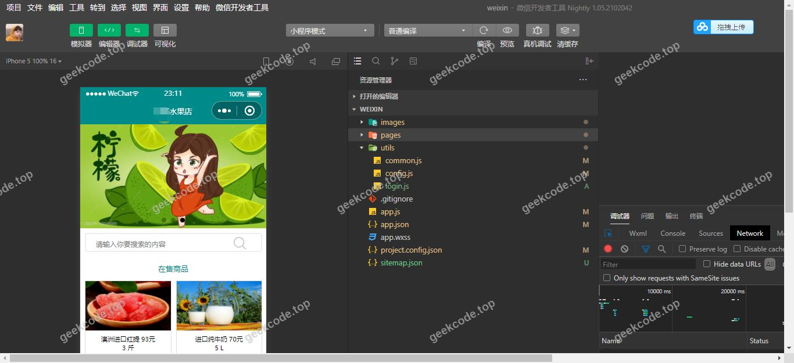
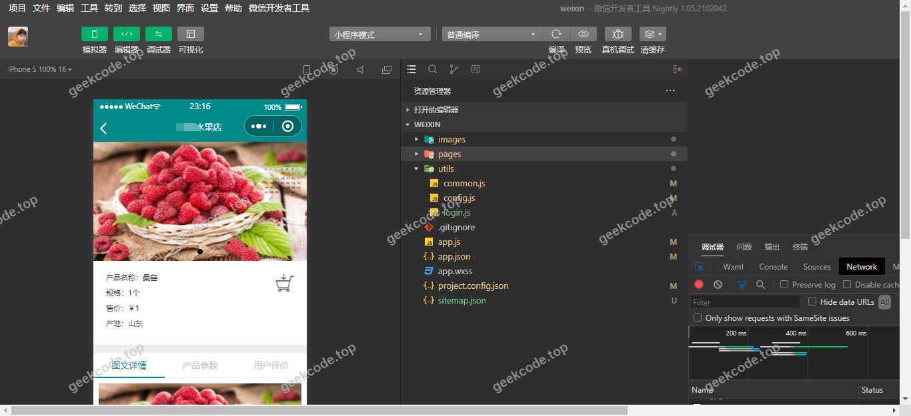
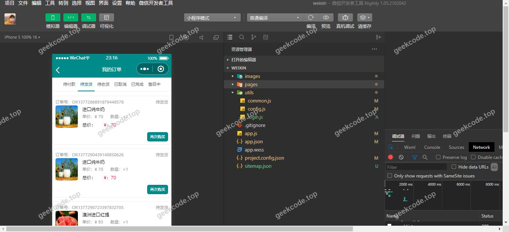
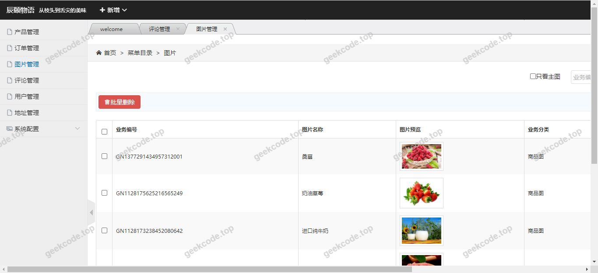
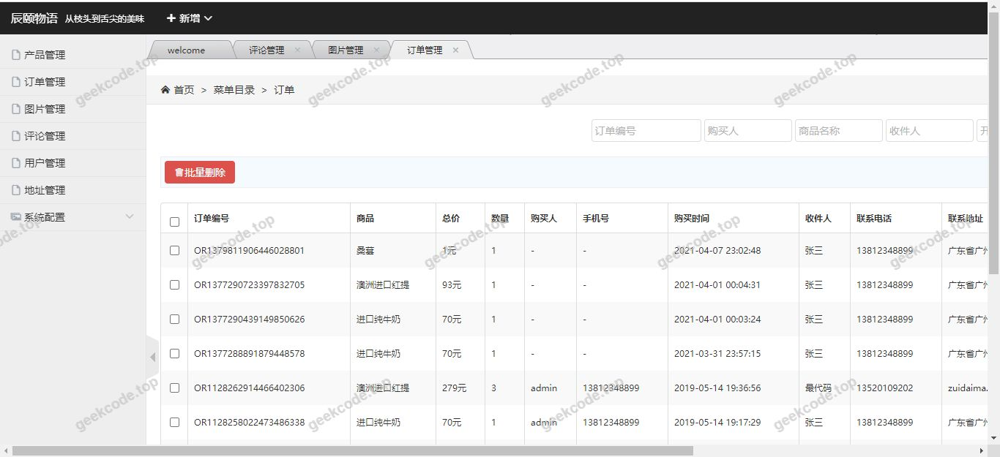
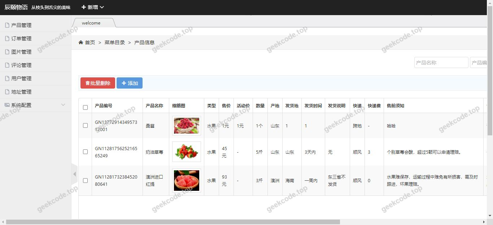

# java精品项目-基于ssm小程序前台+后台水果商城系统

> 🎓 **计算机毕业设计 · java精品项目-基于ssm小程序前台+后台水果商城系统**
>
> 本仓库只放**项目介绍 + 运行截图**（截图是站点带水印的原图，存在仓库 `images/` 里）。
>
> 👉 **完整可运行源码 / 数据库脚本 / 部署文档：[点我获取](https://geekcode.top/archives/java%E7%B2%BE%E5%93%81%E9%A1%B9%E7%9B%AE-%E5%9F%BA%E4%BA%8Essm%E5%B0%8F%E7%A8%8B%E5%BA%8F%E5%89%8D%E5%8F%B0-%E5%90%8E%E5%8F%B0%E6%B0%B4%E6%9E%9C%E5%95%86%E5%9F%8E%E7%B3%BB%E7%BB%9F?utm_source=github)**
>
> 💬 咨询微信：**ir9372**　|　🌐 更多项目：[极客代码 geekcode.top](https://geekcode.top/?utm_source=github)
>
> 📌 项目详情页：<https://geekcode.top/archives/java%E7%B2%BE%E5%93%81%E9%A1%B9%E7%9B%AE-%E5%9F%BA%E4%BA%8Essm%E5%B0%8F%E7%A8%8B%E5%BA%8F%E5%89%8D%E5%8F%B0-%E5%90%8E%E5%8F%B0%E6%B0%B4%E6%9E%9C%E5%95%86%E5%9F%8E%E7%B3%BB%E7%BB%9F?utm_source=github>

<table><td width="230" align="center"> <b>扫码加微信 ir9372</b></td><td valign="middle">📦 源码 = 项目介绍 + 全部运行截图 + 数据库 + 部署文档 👉 点上方任意截图，直接跳到 <b>极客代码 geekcode.top</b> 详情页</td></table>

---

<h1>java精品项目-基于ssm小程序前台+后台水果商城系统</h1>
<h2>项目概述</h2>

本项目为基于 SSM（Spring + Spring MVC + MyBatis）架构结合小程序技术的水果商城系统，旨在构建一个集前台用户购物与后台管理于一体的电子商务平台。项目核心功能涵盖水果商品展示、在线选购、订单管理及后台数据维护。适用人群包括普通消费者及系统管理员。技术架构上采用 Java 后端服务提供 RESTful API，前端通过微信小程序实现移动端交互，利用 Redis 缓存提升访问性能，JWT 实现无状态身份认证，Druid 监控数据库连接池，确保系统在高并发场景下的稳定性与安全性。

<h2>技术架构</h2>

<strong>后端架构：</strong>
系统后端基于 Spring Boot 框架开发，整合 MyBatis-Plus 作为持久层框架，简化 SQL 编写与 CRUD 操作。使用 Druid 作为数据库连接池，提供高效的连接管理与监控能力。引入 JWT (JSON Web Token) 进行用户身份验证，实现前后端分离下的安全通信。集成 Redis 作为缓存中间件，用于存储热点数据如商品信息、用户会话等，降低数据库压力并提升响应速度。

<strong>前端架构：</strong>
前端采用微信小程序技术栈，通过调用后端提供的 HTTP 接口获取数据并渲染页面。小程序端负责用户界面展示、交互逻辑处理及本地状态管理。

<strong>数据库设计要点：</strong>
数据库选用 MySQL，主要表结构涵盖用户信息表、水果商品表、订单主表、订单详情表及购物车表。通过外键关联保证数据一致性，并对常用查询字段建立索引以优化检索效率。

<strong>核心技术选型理由：</strong>
MyBatis-Plus 提高了开发效率；Redis 解决了高并发读取瓶颈；JWT 避免了 Session 共享问题，适合分布式部署；Druid 提供了强大的监控功能，便于排查性能问题。

<h2>功能模块</h2>

根据现有代码上下文及截图信息，系统主要包含以下功能模块：

<strong>1. 前台用户端（小程序）</strong>

<ul>
<li><strong>首页展示</strong>：展示热门水果推荐、分类导航及促销信息。</li>
<li><strong>商品浏览</strong>：支持按类别筛选、关键词搜索查看水果详情（图片、价格、库存）。</li>
<li><strong>购物车管理</strong>：添加商品至购物车、修改数量、删除商品、计算总价。</li>
<li><strong>订单结算</strong>：确认收货地址、选择支付方式、提交订单。</li>
<li><strong>个人中心</strong>：查看历史订单、个人信息维护。</li>
</ul>

<strong>2. 后台管理端</strong>

<ul>
<li><strong>用户管理</strong>：查看注册用户列表、禁用/启用账号。</li>
<li><strong>商品管理</strong>：新增、编辑、删除水果商品信息，上传商品图片，设置库存与价格。</li>
<li><strong>订单管理</strong>：查看所有订单状态（待支付、已发货、已完成），处理退款申请。</li>
<li><strong>数据统计</strong>：查看销售额趋势、热销商品排行等基础业务报表。</li>
</ul>

<em>(注：具体菜单项名称依据通用电商系统设计推导，实际界面以运行截图为准)</em>

<h2>用户角色与权限</h2>

系统主要涉及两类用户角色，其权限划分如下：

<strong>1. 普通用户（消费者）</strong>

<ul>
<li><strong>可访问功能</strong>：</li>
<li>浏览所有公开的商品信息。</li>
<li>注册与登录账号。</li>
<li>管理个人购物车。</li>
<li>创建和支付订单。</li>
<li>查看自己的历史订单记录。</li>
<li>编辑个人资料。</li>
<li><strong>不可访问功能</strong>：无法进入后台管理系统，无法查看其他用户数据或修改商品库存。</li>
</ul>

<strong>2. 系统管理员</strong>

<ul>
<li><strong>可访问功能</strong>：</li>
<li>登录后台管理系统。</li>
<li>对商品信息进行增删改查操作。</li>
<li>管理用户账户状态。</li>
<li>处理所有订单的状态变更（如发货、取消）。</li>
<li>查看全局销售数据和统计报表。</li>
<li><strong>不可访问功能</strong>：通常不直接参与前台购物流程，但拥有最高数据读写权限。</li>
</ul>
<h2>项目特色与创新点</h2>
<ol>
<li><strong>高性能缓存策略</strong>：通过 Redis 缓存高频访问的商品列表和用户会话信息，显著降低了 MySQL 数据库的负载，提升了小程序端的加载速度和用户体验。</li>
<li><strong>安全无状态认证</strong>：采用 JWT 机制替代传统 Session，不仅减少了服务器内存占用，还天然支持跨域请求和多端登录，符合现代微服务架构的安全规范。</li>
<li><strong>高效持久层开发</strong>：利用 MyBatis-Plus 的代码生成器和条件构造器，大幅减少了重复性 CRUD 代码的编写，使开发人员能更专注于业务逻辑的实现。</li>
<li><strong>实时监控与维护</strong>：集成 Druid 连接池监控，管理员可实时查看 SQL 执行耗时、连接池使用情况，有助于快速定位性能瓶颈和潜在的安全风险。</li>
</ol>
<h2>部署环境</h2>

为确保系统正常运行，需准备以下软件环境：

<ul>
<li><strong>JDK</strong>: 版本建议 JDK 8 或 JDK 11+（需兼容 Spring Boot 版本）。</li>
<li><strong>MySQL</strong>: 版本 5.7 或 8.0+，需初始化项目所需的数据库脚本。</li>
<li><strong>Redis</strong>: 版本 5.0+，用于运行缓存服务。</li>
<li><strong>Maven</strong>: 版本 3.6+，用于项目依赖管理和打包。</li>
<li><strong>微信开发者工具</strong>: 最新稳定版，用于调试和预览小程序前端代码。</li>
<li><strong>Node.js</strong>: 若前端工程化需要，建议安装 LTS 版本（视具体前端构建工具而定）。</li>
<li><strong>操作系统</strong>: Windows 10/11, macOS 或 Linux (CentOS/Ubuntu)。</li>
</ul>
<h2>五、技术特性</h2>
<ul>
<li>使用 MyBatis-Plus 简化数据访问层开发</li>
<li>采用 JWT Token 机制实现无状态认证</li>
<li>使用 Redis 缓存提升系统性能</li>
</ul>
<h2>六、功能模块截图</h2>
<h3>前台用户端</h3>
<h4>系统运行界面1</h4>

<h4>系统运行界面2</h4>

<h4>系统运行界面3</h4>

<h4>系统运行界面4</h4>

<h4>系统运行界面5</h4>

<h4>系统运行界面6</h4>

---

## 获取完整源码

| 项目 | 说明 |
| --- | --- |
| 项目名 | java精品项目-基于ssm小程序前台+后台水果商城系统 |
| 运行截图 | 本文 6 张（站点带水印原图，仓库 `images/` 目录） |
| 完整源码 | [https://geekcode.top/archives/java%E7%B2%BE%E5%93%81%E9%A1%B9%E7%9B%AE-%E5%9F%BA%E4%BA%8Essm%E5%B0%8F%E7%A8%8B%E5%BA%8F%E5%89%8D%E5%8F%B0-%E5%90%8E%E5%8F%B0%E6%B0%B4%E6%9E%9C%E5%95%86%E5%9F%8E%E7%B3%BB%E7%BB%9F?utm_source=github](https://geekcode.top/archives/java%E7%B2%BE%E5%93%81%E9%A1%B9%E7%9B%AE-%E5%9F%BA%E4%BA%8Essm%E5%B0%8F%E7%A8%8B%E5%BA%8F%E5%89%8D%E5%8F%B0-%E5%90%8E%E5%8F%B0%E6%B0%B4%E6%9E%9C%E5%95%86%E5%9F%8E%E7%B3%BB%E7%BB%9F?utm_source=github) |
| 咨询微信 | **ir9372**（备注：jingpin-yuanma） |
| 更多项目 | [极客代码 geekcode.top](https://geekcode.top/?utm_source=github) |

> 需要源码、部署、改配置、跑不起来等问题，加微信 ir9372 沟通，说明项目名即可。
